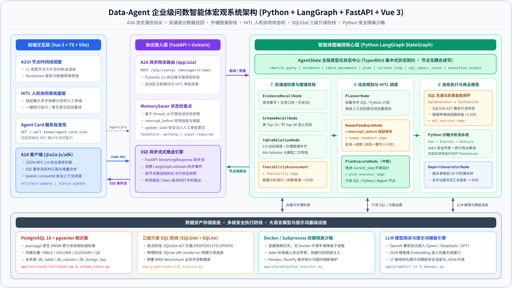
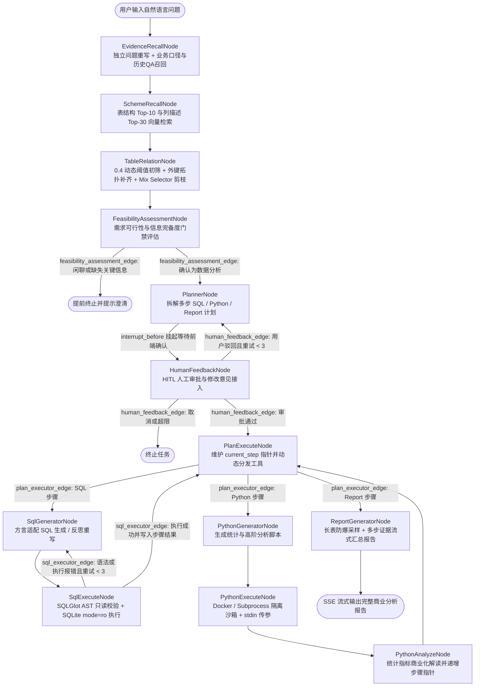
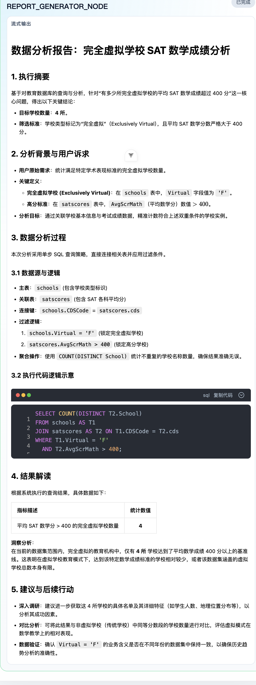

# 🚀 Data-Agent: 基于 LangGraph + FastAPI + Vue 3 的企业级问数智能体

> **Data-Agent** 是一个面向复杂业务场景构建的全栈式数据分析与问数智能体（Text2SQL & Python Data Agent）。  
> 系统基于 **LangGraph 有向状态图编排**、**FastAPI 异步流式网关 (A2A / SSE)**、**PostgreSQL + pgvector 多维知识检索** 与 **Vue 3 + TypeScript 节点时间线前端**，打通了从自然语言理解、双通道元数据召回、外键图谱剪枝、HITL 人机协同审批、三级只读 SQL 自愈执行、Python 安全沙箱二次计算到商业决策报告流式交付的白盒化闭环。

<p align="left">
  
  
  
  
  
  
  
</p>

---

## 📌 目录导航

- [宏观系统架构图](#-宏观系统架构图)
- [LangGraph 状态机编排拓扑](#-langgraph-状态机编排拓扑)
- [核心工程设计亮点](#-核心工程设计亮点)
- [运行效果预览](#-运行效果预览)
- [技术栈清单](#️-技术栈清单)
- [快速启动 (3 分钟体验)](#-快速启动-3-分钟体验)
- [项目目录结构](#-项目目录结构)
- [开源协议](#-开源协议)

---

## 🧭 宏观系统架构图

<p align="center">
  
</p>

---

## 🔄 LangGraph 状态机编排拓扑

所有节点均严格围绕集中式 `AgentState` 进行无耦合读写，通过 **4 条确定性条件路由边** 实现门禁拦截、人工驳回回跳、多步指针循环调度与 SQL 报错自愈：



---

## ✨ 核心工程设计亮点

### 1. 白盒化状态机编排与 HITL 人机协同 (`LangGraph + MemorySaver`)
- **严格的状态读写契约**：全局状态沉淀于 `AgentState`（`TypedDict`），节点间禁止隐式直连；明确区分状态覆盖与按步骤累积（如 `execution_output["step_N"]`），确保多步 SQL 与 Python 串联执行互不污染。
- **无损挂起与驳回重排**：利用 `interrupt_before=["HUMAN_FEEDBACK_NODE"]` 与 `MemorySaver` 检查点机制，在规划完成后自动挂起状态机并向前端推送待审计划；当用户驳回并输入修改意见时，通过 `update_state` 注入反馈并经 `human_feedback_edge` 安全回跳至 `PlannerNode` 重写计划（支持最多 3 次闭环修正）。

### 2. 四维元数据双通道检索与外键拓扑剪枝 (`PostgreSQL + pgvector`)
- **查询重写与业务证据召回**：先消除多轮对话指代生成独立查询，再并行检索 `GLOSSARY_KNOWLEDGE`（业务术语与指标计算口径）和 `QUESTION_KNOWLEDGE`（历史优质 SQL 样本）。
- **表列分级召回与外键防断裂**：将 `TABLE` 与 `COLUMN` 向量分层检索后，基于 `0.4` 动态相似度阈值锚定核心候选表，顺着物理外键表（`db_foreign_key`）自动扩展桥接中间表，最终交由 `Mix Selector` 剪枝无关噪声字段，兼顾上下文精简度与 `JOIN` 链路完整性。

### 3. 三级只读安全防线、SQL 自愈闭环与双模沙箱 (`SQLGlot + Docker`)
- **前置 AST 静态校验 + 物理只读连接**：在 SQL 触达数据库前，通过 `SQLGlot` 将语句解析为抽象语法树（AST），精准拦截 `DROP / DELETE / UPDATE / INSERT / ALTER / TRUNCATE` 等危险操作及多语句注入；底层采用 SQLite URI 物理只读模式（`file:...?mode=ro`）双重兜底。
- **错误堆栈反思自愈**：当 SQL 执行报错时，状态机自动捕获数据库异常堆栈并回跳 `SqlGeneratorNode` 切换至 `sql-error-fixer` 反思模式，最多自动修复重试 3 次。
- **隔离沙箱与防爆采样**：Python 高阶统计脚本通过 `stdin` 标准输入安全接收前序 SQL 数据，运行于 `Docker` 容器（无 Docker 环境平滑降级受限 `Subprocess`）；最终进入报告节点前对超过 20 行的结果集自动采样截断，防止大模型上下文溢出。

---

## 📊 运行效果预览

<p align="center">
  
</p>

---

## 🛠️ 技术栈清单

| 层级 | 核心技术选型 |
| :--- | :--- |
| **后端网关与异步服务** | `Python 3.12+` · `FastAPI` · `Uvicorn` · `Pydantic v2` · `A2A JSON-RPC / SSE` |
| **智能体图编排** | `LangGraph (StateGraph / MemorySaver)` · `LangChain Core` · `OpenAI SDK` |
| **向量与关系元数据存储** | `PostgreSQL 16` · `pgvector (HNSW 余弦索引)` · `psycopg 3` |
| **执行安全与计算沙箱** | `SQLGlot (AST 静态校验)` · `SQLite3 (URI Read-Only)` · `Docker / Subprocess` · `Pandas / NumPy` |
| **前端交互与可视化** | `Vue 3.5` · `TypeScript` · `Vite` · `Pinia` · `Element Plus` · `@a2a-js/sdk` · `md-editor-v3` |
| **质量保障与评测** | `Pytest` · `Pytest-Asyncio` · 内置 `BIRD Benchmark` 验证数据库（44 项单测与集成测试） |

---

## ⚡ 快速启动 (3 分钟体验)

### 1. 基础环境准备
- **Python**: `>= 3.12`（推荐使用 `uv` 管理环境）
- **Node.js**: `>= 20.19` 或 `>= 22.12`，包管理器使用 `pnpm`
- **PostgreSQL**: `>= 15`，需安装 `pgvector` 扩展

### 2. 初始化 PostgreSQL 元数据与向量库

```bash
# 创建数据库并启用 pgvector 扩展
createdb data_agent_tutorial
psql -d data_agent_tutorial -c "CREATE EXTENSION IF NOT EXISTS vector;"

# 导入元数据表结构、外键关系与预置向量知识库
psql -d data_agent_tutorial -f data-agent-backend-python/data/database.sql
```

### 3. 配置与启动 Python 后端

```bash
cd data-agent-backend-python

# 1. 复制环境变量模板并填入你的大模型 API Key
cp .env.example .env

# 2. 安装项目依赖
uv sync
# 或使用标准 venv:
# python3 -m venv .venv && source .venv/bin/activate && pip install -e .

# 3. 启动后端服务 (默认监听 http://0.0.0.0:9933)
uv run uvicorn main:app --host 0.0.0.0 --port 9933 --reload
```

### 4. 启动前端交互界面

新开一个终端窗口：

```bash
cd data-agent-frontend

pnpm install
pnpm dev
```

浏览器访问 **`http://localhost:3500`**，选择数据库（如内置开箱即用的 `california_schools`），输入自然语言问题即可实时观察完整图节点流转轨迹！

### 5. 运行自动化测试套件

```bash
cd data-agent-backend-python
uv run pytest tests/ -m "not e2e" -v
```

---

## 📁 项目目录结构

```text
.
├── assets/readme/                    # 系统架构矢量图与前端运行预览图
├── data-agent-backend-python/        # Python LangGraph 后端核心工程
│   ├── app/
│   │   ├── a2a/                      # A2A JSON-RPC 协议路由与 SSE 流式推送
│   │   ├── graph/                    # StateGraph 拓扑组装、条件边与 13 个业务节点
│   │   ├── prompts/                  # 17 套 .st 结构化提示词模板与渲染管理器
│   │   ├── retrieval/                # pgvector 向量检索器与表/列/外键元数据仓库
│   │   └── shared/                   # Docker / Subprocess 双模 Python 安全执行沙箱
│   ├── data/                         # PostgreSQL 初始化 SQL 与 BIRD 评测数据集
│   ├── tests/                        # 单元测试与节点链路集成测试集
│   ├── main.py                       # FastAPI 服务入口
│   ├── pyproject.toml                # 项目依赖与构建配置
│   └── .env.example                  # 环境变量配置模板
└── data-agent-frontend/              # Vue 3 + TypeScript 交互式前端工程
    ├── src/
    │   ├── components/               # 11 类智能体节点实时卡片与 HITL 审批组件
    │   ├── constants/                # 前后端对齐的状态键与节点契约定义
    │   └── App.vue                   # 流式会话时间线主界面
    └── package.json
```

---

## 📄 开源协议

本项目基于 [MIT License](LICENSE) 开源协议发布。
