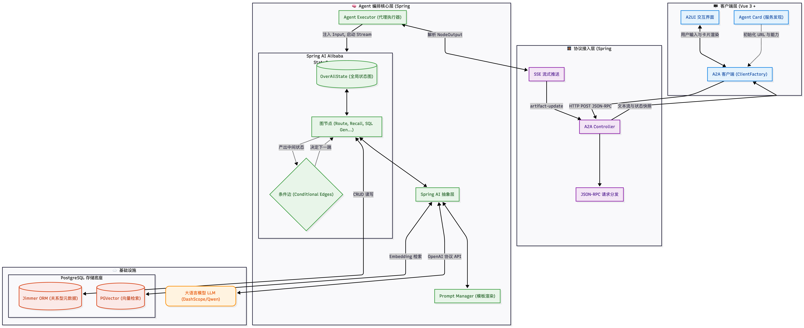

# 🚀 Data-Agent: 基于 LangGraph + Vue 3 的企业级 Text2SQL 智能体

> 本项目是一个**纯 Python 现代技术栈实现的企业级 Text2SQL 智能体系统**。  
> 基于 **LangGraph 状态图编排**、**FastAPI 异步高性能后端** 与 **Vue 3 + TypeScript 交互式前端**，完整复现并增强了双通道 RAG 知识召回、任务拆解规划（Planner）、HITL 人机协同审批、SQL 自我纠错循环、Python 沙箱高阶分析与商业图表报告流式输出。

<p align="left">
  
  
  
  
  
</p>

---

## 💡 致谢与项目背景 (Attribution & Credits)

本项目的设计思路与业务流程参考并致敬以下优秀的开源项目与教程：

1. **[qifan777/data-agent-tutorial](https://github.com/qifan777/data-agent-tutorial)**：原作者 [起凡 (qifan777)](https://github.com/qifan777) 出品的优秀 Text2SQL 教程（基于 Kotlin + Spring AI Alibaba Graph 体系）。本项目将该架构思想进行了系统的工程拆解，并全面重写为纯 Python (LangGraph) 实现。
2. **[spring-ai-alibaba/DataAgent](https://github.com/spring-ai-alibaba/DataAgent)**：Spring AI 官方生态中的企业级 Text2SQL Agent 参考架构。

在此特别感谢原作者的技术分享与开拓！本项目在复现过程中针对 Python 生态做了如下扩展与增强：
- **纯 Python 原生 LangGraph 图状态机**：彻底摆脱 JVM 依赖，拥抱 Python 生态丰富的大模型工具链与数据分析库（Pandas, NumPy, SciPy）。
- **Docker / Subprocess 双模安全沙箱**：强化 Python 代码执行安全性，具备标准输入安全注入与崩溃自恢复机制。
- **Token 暴涨前置防护**：对长表格数据在输入 Report 节点前实施动态安全采样，彻底避免超出 LLM 上下文导致的超时与崩溃。
- **开箱即用的 Benchmark 内置**：内置 BIRD Benchmark SQLite 数据库集合与 PostgreSQL 知识库初始化脚本，无需额外复杂配置。

---

## 📌 目录导航

- [系统架构图](#-宏观系统架构图)
- [核心亮点与执行链路](#-核心亮点与执行链路)
- [技术栈清单](#️-技术栈清单)
- [快速启动](#-快速启动-3-分钟体验)
- [项目结构](#-项目结构)
- [常见问题与开源协议](#-开源协议)

---

## 🧭 宏观系统架构图

<p align="center">
  
</p>

---

## ✨ 核心亮点与执行链路

```text
[用户自然语言提问]
   └── A2A 协议流式请求 (FastAPI SSE)
        └── 意图识别 (Intent Recognition)
             ├── 知识召回 (Query Rewrite + PGVector 语义知识匹配)
             ├── 关系图谱扩展与剪枝 (Mix Selector 候选表降噪)
             ├── 可行性评估与任务拆解 (Planner 动态生成多步计划)
             ├── 人机协同拦截 (HITL Human-In-The-Loop 审批/调整)
             ├── SQL 执行循环 (SQL 生成 -> SQLite 执行 -> 报错反思自我纠错)
             ├── Python 深度计算 (Docker/Subprocess 沙箱执行 -> 商业分析)
             └── 综合报告生成 (Report Generator 流式打字机 + ECharts 结构化渲染)
```

1. **双通道 RAG 知识检索**：结合业务术语向量化检索与关系数据库 Schema 外键拓扑，避免传统 Text2SQL 的“幻觉表”与“列名混淆”。
2. **状态驱动的自纠错能力**：SQL 执行遇到语法错误、字段缺失或执行异常时，状态机自动触发 `sql_error_fixer`，携带数据库错误日志反思修正，支持多次重试。
3. **安全沙箱二次计算**：面对百分位数、分箱、同比环比等 SQL 难以处理的复杂统计，Agent 自动编写 Python 代码并在隔离沙箱中运行并产出分析结论。
4. **实时交互与可观测性**：前端通过 A2A 协议流式订阅每个节点的思考状态、SQL 查询结果、可视化图表及 Markdown 报告，过程透明可追溯。

<p align="center">
  
</p>

---

## 🛠️ 技术栈清单

- **后端应用**：`Python 3.12+` / `FastAPI` / `Uvicorn`
- **Agent 图编排**：`LangGraph` / `LangChain Core`
- **SQL 与数据安全**：`SQLGlot` / `SQLite3` / `Docker SDK`
- **向量与元数据存储**：`PostgreSQL 16` + `pgvector`
- **前端交互**：`Vue 3` / `TypeScript` / `Vite` / `Pinia` / `MdPreview` / `ECharts`

---

## ⚡ 快速启动 (3 分钟体验)

### 1. 基础环境准备
- **Python**: `>= 3.12`
- **Node.js**: `>= 20.x`，推荐使用 `pnpm`
- **PostgreSQL**: `>= 15`，已安装 `pgvector` 插件

### 2. 初始化知识库数据
在 PostgreSQL 中创建数据库并执行初始化脚本：

```bash
# 创建数据库并启用 pgvector
createdb data_agent_tutorial
psql -d data_agent_tutorial -c "CREATE EXTENSION IF NOT EXISTS vector;"

# 导入知识库表结构与预置语义数据
psql -d data_agent_tutorial -f data-agent-backend-python/data/database.sql
```

### 3. 配置与启动 Python 后端

```bash
cd data-agent-backend-python

# 1. 配置环境变量
cp .env.example .env
# 编辑 .env 文件，填入你的 OPENAI_API_KEY 及模型配置

# 2. 安装依赖 (使用 uv 或标准 pip)
uv sync
# 或者:
# python3 -m venv .venv && source .venv/bin/activate && pip install -e .

# 3. 启动服务 (默认端口 9933)
uvicorn main:app --host 0.0.0.0 --port 9933 --reload
```

### 4. 启动前端页面

新开终端窗口：

```bash
cd data-agent-frontend

# 安装依赖并启动
pnpm install
pnpm dev
```

浏览器打开 `http://localhost:3500`，即可开始对话！

---

## 📁 项目结构

```text
.
├── assets/                       # 架构图、流程图与演示资产
├── docs/                         # 项目复现设计笔记与深度解析
├── data-agent-backend-python/    # Python LangGraph 后端服务
│   ├── app/                      # 核心业务逻辑
│   │   ├── a2a/                  # A2A SSE 流式协议实现
│   │   ├── graph/                # LangGraph 节点、边与状态机
│   │   ├── prompts/              # 统一提示词工程
│   │   └── sandbox/              # 安全 Python 执行沙箱
│   ├── data/                     # BIRD 数据集与 PostgreSQL SQL 脚本
│   ├── tests/                    # 完整单元与集成测试用例
│   ├── pyproject.toml            # 依赖声明
│   └── .env.example              # 环境变量模板
└── data-agent-frontend/          # Vue 3 前端卡片交互与流式渲染
    ├── src/                      # 源码 (A2UI 组件、节点卡片、状态流)
    └── package.json
```

---

## 📄 开源协议

本项目采用 [MIT License](LICENSE) 开源协议。  
欢迎学习、Fork 与提交 PR！如在项目中引用或二次开发，请保留对原项目与教程作者的鸣谢。
